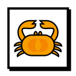
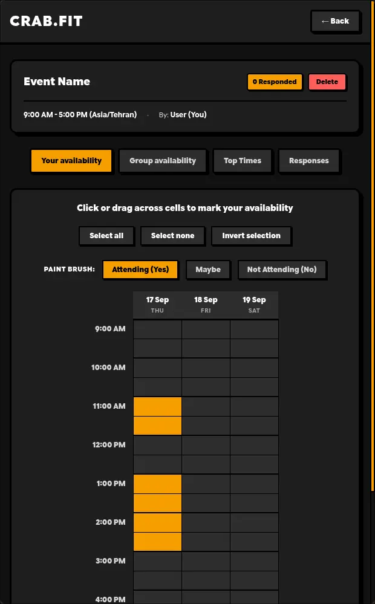

<p align="center">
  
</p>
<h1 align="center">Crab.Fit</h1>

**Crab.Fit** is a [webxdc](https://webxdc.org) app, a port of the popular [Crab.Fit](https://crab.fit) scheduler so your group can find the best time to meet without accounts or leaving the chat:

- 📅 **Create events** — Pick a title, specific dates or recurring weekdays, a daily time range, and a timezone
- ✅ **Mark availability** — Click or drag across the grid to set Yes / Maybe / No for every slot
- 🔥 **Group heatmap** — See at a glance how many people are free in each slot
- 🏆 **Top Times** — Ranked list of the best overlapping slots so the group can decide quickly
- 🎯 **Pick a final time** — The event creator can lock in the chosen slot; everyone sees the banner

## Screenshot



## Development

The app is built with Vite + Tailwind CSS.

```bash
pnpm install
pnpm dev          # development server on http://localhost:3000
pnpm build        # production build → dist/
```

Outside Delta Chat a built-in `webxdc` fallback is used, so the app works in the browser with local persistence. Open multiple tabs to simulate several participants.

To test real chat integration, you have two options:
- Run `pnpm build` and `./git-assets/make-xdc.sh -d` to create `temp/app.xdc`
- Package the contents of `dist/` into a `.zip` archive, rename the extension to `.xdc`, and send it into any supported messenger (like Delta Chat).
